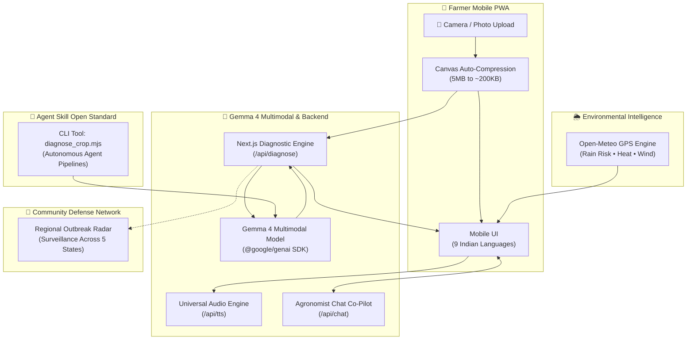

# 🌾 AgriGemma — On-Field Crop Disease & Pest Diagnostic Platform
> **Built for Hacktoberfest 2026 × Google DeepMind Gemma 4 Challenge**  
> *Tracks: Real-World Multimodal AI • Open-Source Impact • Agent Skill Open Standard*

[](LICENSE)
[](https://deepmind.google/technologies/gemma/)
[-black.svg)](https://nextjs.org/)
[](skills/agrigemma-crop-pathologist/SKILL.md)
[](#-9-indian-agricultural-languages)

---

## 🌍 The Real-World Problem
Smallholder farmers produce over **one-third of the global food supply**, yet lose between **20% to 40% of their annual crop yield** to preventable plant diseases and pest infestations.

In rural Indian farming communities:
* **Agronomist Shortage:** Certified plant pathologists and Krishi Vigyan Kendra (KVK) scientists are geographically distant and unaffordable for smallholders.
* **Costly Chemicals:** Defaulting to expensive commercial fungicides degrades soil biology, strains farm finances, and creates chemical resistance.
* **Language & Literacy Barriers:** Complex printed manuals or technical portals fail to reach farmers who communicate exclusively in regional mother tongues.
* **Bandwidth Constraints:** Patchy 2G/3G connectivity in fields prevents uploading multi-megabyte camera photos to standard cloud endpoints.
* **Isolated Defense:** Crop diseases spread through windborne spores across neighboring farms; lack of early warning blinds entire farming clusters.

---

## 💡 How AgriGemma Solves It with Gemma 4

**AgriGemma** turns any basic smartphone into an intelligent, on-field Krishi Co-Pilot and community surveillance network:

1. **Multimodal Leaf & Stem Pathology:** A farmer snaps a photo of infected leaves, stems, or pests. Gemma 4 analyzes visual symptom patterns (e.g. concentric chlorotic rings, powdery fungal mildew, thrips scarring) with high clinical accuracy.
2. **Accessible & Low-Cost Organic Remedies:** Prioritizes localized remedies smallholders already possess (neem oil, buttermilk spray, wood ash, baking soda, pruning, companion planting).
3. **🌦️ Weather-Smart Spray Advisory:** Uses real-time GPS meteorological data (via Open-Meteo) to advise whether it is safe to spray today or if rain/heat will wash remedies away.
4. **💬 "Ask the Agronomist" Multimodal Chat:** Farmers can ask multi-turn follow-up questions while retaining original leaf imagery and diagnosis context.
5. **📡 Regional Outbreak Radar:** A community surveillance early-warning system mapping live disease clusters across Indian agricultural districts with audio broadcast warnings.
6. **🤖 Official Agent Skill Package:** Conforms to the **Agent Skill Open Standard** (`skills/agrigemma-crop-pathologist/SKILL.md`), allowing autonomous AI agents to audit farm crops via CLI or CI/CD pipelines.
7. **Bandwidth-Aware Rural Compression:** Client-side HTML5 canvas compression reduces 5MB photos down to ~200KB before transmission.

---

## 🇮🇳 9 Indian Agricultural Languages Supported

AgriGemma features a dynamic, zero-English-leakage localization engine. Switching languages updates the entire UI, diagnosis, suggested question chips, and audio readouts:

| Language | Script | Spoken Voice Output |
| :--- | :--- | :---: |
| **English (India)** | Latin | Native Indian English |
| **हिंदी (Hindi)** | Devanagari (देवनागरी) | 🔊 Authentic Hindi |
| **मराठी (Marathi)** | Devanagari (मराठी) | 🔊 Authentic Marathi |
| **తెలుగు (Telugu)** | Telugu (తెలుగు లిపి) | 🔊 Authentic Telugu |
| **தமிழ் (Tamil)** | Tamil (தமிழ் அரிச்சுவடி) | 🔊 Authentic Tamil |
| **ಕನ್ನಡ (Kannada)** | Kannada (ಕನ್ನಡ ಲಿಪಿ) | 🔊 Authentic Kannada |
| **বাংলা (Bengali)** | Bengali (বাংলা লিপি) | 🔊 Authentic Bengali |
| **ગુજરાતી (Gujarati)** | Gujarati (ગુજરાતી લિપિ) | 🔊 Authentic Gujarati |
| **ਪੰਜਾਬੀ (Punjabi)** | Gurmukhi (ਗੁਰਮੁਖੀ) | 🔊 Authentic Punjabi |

---

## 🏗️ System Architecture



---
## 🤖 Agent Skill Open Standard Compliance
AgriGemma includes an official **Agent Skill** (`skills/agrigemma-crop-pathologist/SKILL.md`) complying with the **Agent Skill Open Standard**.
Autonomous AI agents (in Antigravity, Claude, AutoGPT, or GitHub Actions) can invoke AgriGemma directly from CLI or automated drone/satellite image pipelines:
### CLI Usage:
```bash
# Diagnose via image URL in Marathi
node skills/agrigemma-crop-pathologist/scripts/diagnose_crop.mjs \
  --url "https://images.unsplash.com/photo-1592150621744-aca64f48394a?w=400" \
  --lang "Marathi"
# Diagnose local field photo in Hindi
node skills/agrigemma-crop-pathologist/scripts/diagnose_crop.mjs \
  --image ./samples/leaf_blight.jpg \
  --lang "Hindi"
JSON Output Sample:
json
{
  "crop": "टोमॅटो",
  "detectedCondition": "अगेती करपा रोग (Early Blight)",
  "isHealthy": false,
  "confidence": "High",
  "severity": "Moderate",
  "symptomsIdentified": [
    "पानांच्या कडांवर गोलाकार तपकिरी ठिपके",
    "ठिपक्यांभोवती पिवळे वलय (Chlorosis)"
  ],
  "organicRemedies": [
    "१ लिटर पाण्यात १ चमचा बेकिंग सोडा आणि थोडा साबणाचा अर्क मिसळून फवारणी करा",
    "संध्याकाळी ५ मिली प्रति लिटर या प्रमाणात कडुलिंबाच्या तेलाची (Neem Oil) फवारणी करा"
  ],
  "culturalPractices": [
    "जमिनीलगतची रोगट पाने छाटून नष्ट करा",
    "पानांवर पाणी उडणार नाही याची काळजी घ्या; थेट मुळांशी पाणी द्या"
  ],
  "audioSummary": "तुमच्या टोमॅटो पिकावर करपा रोग झाला आहे. रोगट पाने तोडून टाका आणि बेकिंग सोड्याच्या पाण्याची फवारणी करा."
}